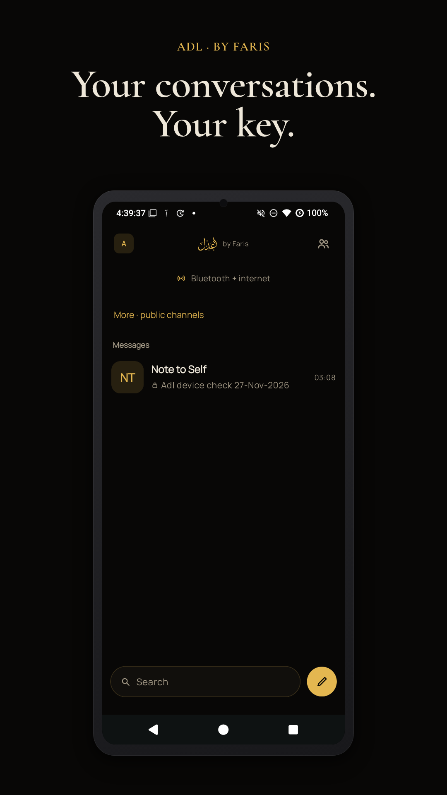
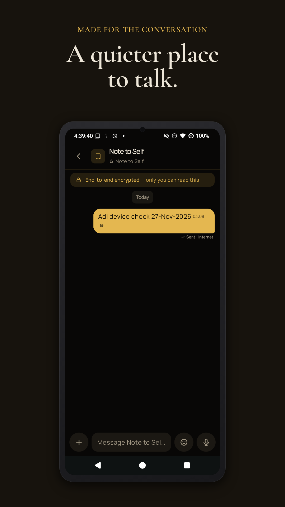
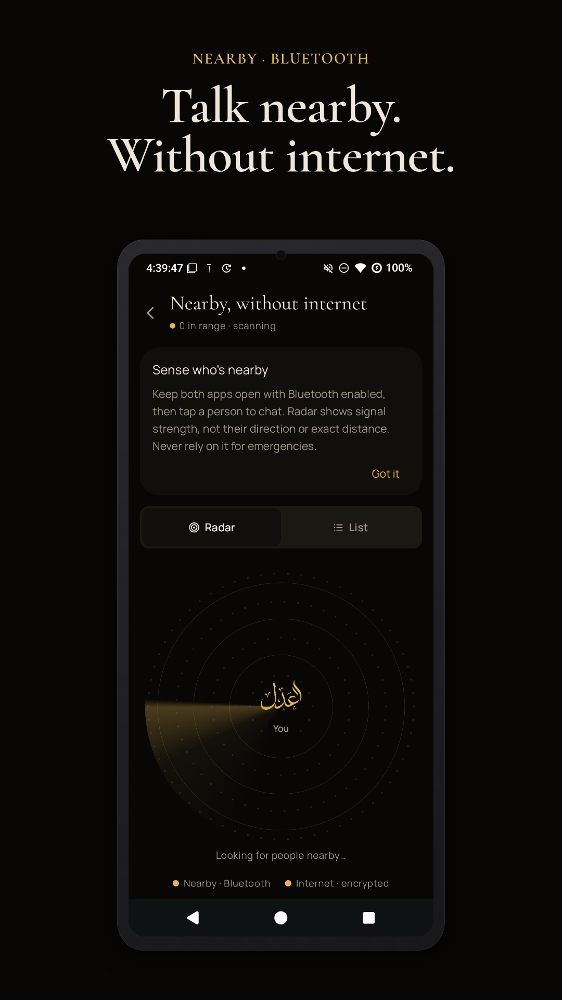
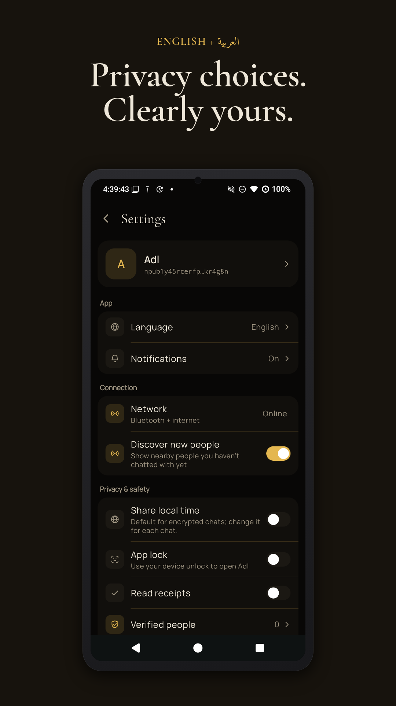
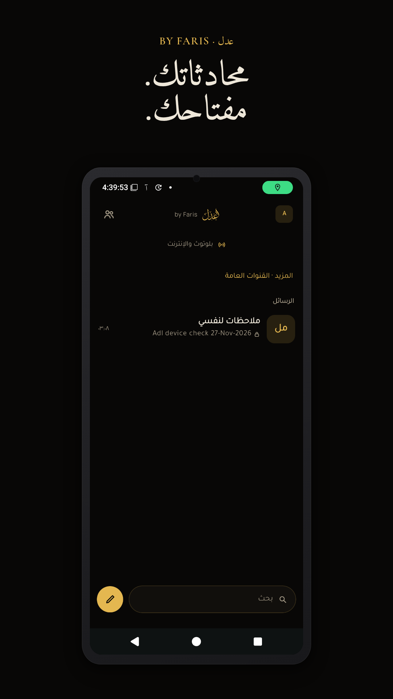
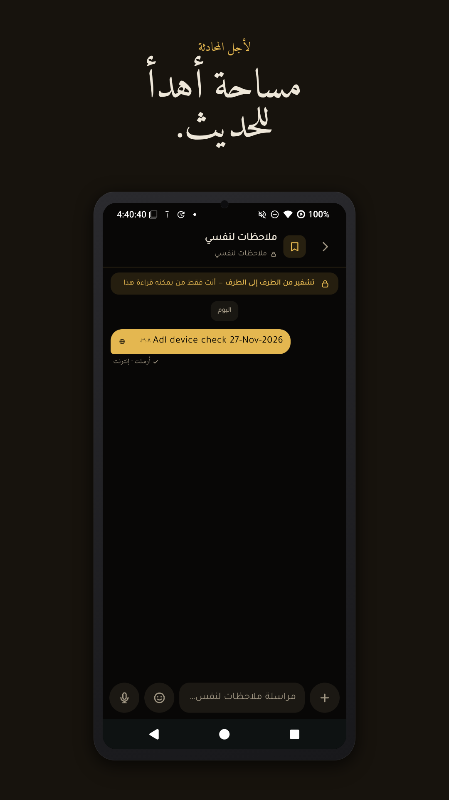
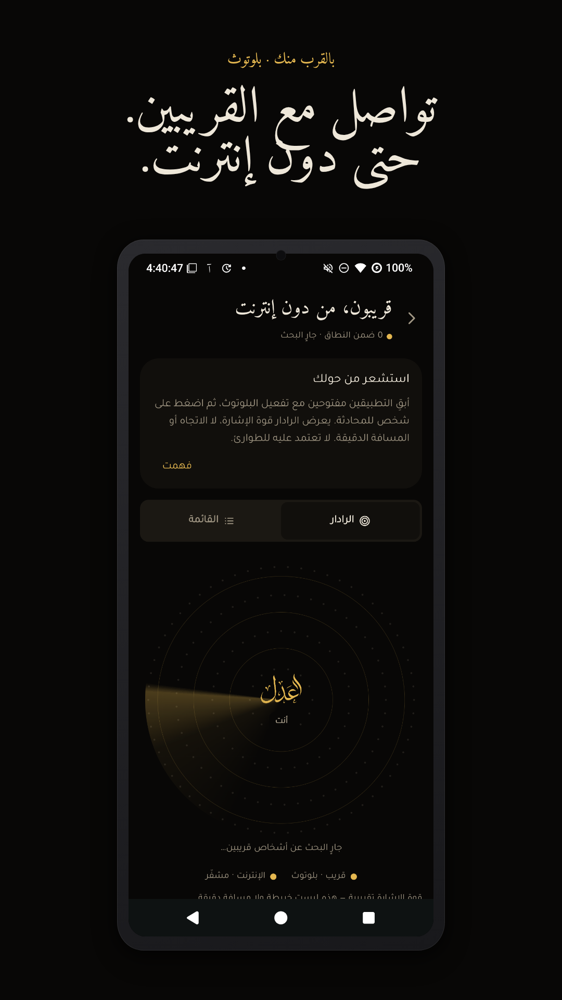
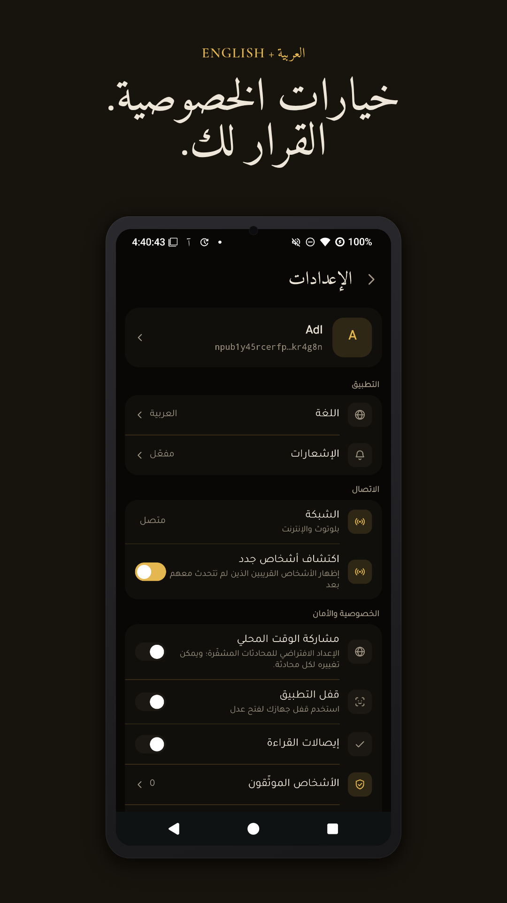

# Adl releases

Download artifacts for **Adl — عدل by Faris**, the private messenger for
attorneys and clients. Source code lives in the private repository
[`Syoolah-Apps/adl-sonar-mobile`](https://github.com/Syoolah-Apps/adl-sonar-mobile).

## Current release — v0.1-alpha.1 (signed alpha)

| File | Purpose |
|------|---------|
| [`adl-v0.1-alpha.1.apk`](https://github.com/Syoolah-Apps/adl-releases/releases/download/v0.1-alpha.1/adl-v0.1-alpha.1.apk) | Signed Android APK, version code 34 |
| `adl-v0.1-alpha.1.apk.sha256` | SHA-256 checksum of the APK above |

- Package: `chat.adl.sonar`
- Version: `0.1-alpha.1` (versionCode 34), minSdk 26, targetSdk 35
- APK SHA-256: `c3b85c786c23c84e87e6c593a5145f63b9b7c369e22af3b5e0848af522b30db1`
- Signing certificate SHA-256: `46DC9EE3D75BEDC0133781CDF49AAAB27F1233C5C4B5E5C3E6BB15FDB8FF5FEE`
- Built from source commit `27f62a21`

### Verify before installing

```sh
sha256sum -c adl-v0.1-alpha.1.apk.sha256
```

The output must say `adl-v0.1-alpha.1.apk: OK`.

### Installing on Android

Open the APK link on your Android device. Android will ask you to allow the
app that opened the file (your browser or file manager) to install unknown
apps. Allow it only for that app, install, then turn the permission off again.
Keep Play Protect enabled. The app does not bypass Android security warnings;
do not ignore a warning you do not understand.

If you had an earlier unsigned or debug build installed, Android will refuse
to update it over this signed build because the signing keys differ. Back up
anything you need, then remove the old build before installing this one.

### Screenshots

Captured from the tested build (same source as this signed alpha). Nearby shows
an empty first-use radar — no example contacts are presented as real peers.

**English**

| Home | Chat |
| --- | --- |
| [](screenshots/en/01-home.png) | [](screenshots/en/02-chat.png) |

| Nearby | Settings |
| --- | --- |
| [](screenshots/en/03-nearby.png) | [](screenshots/en/04-settings.png) |

**العربية**

| الرئيسية | المحادثة |
| --- | --- |
| [](screenshots/ar/01-home.png) | [](screenshots/ar/02-chat.png) |

| الأجهزة القريبة | الإعدادات |
| --- | --- |
| [](screenshots/ar/03-nearby.png) | [](screenshots/ar/04-settings.png) |

### Status

This is an **alpha**, distributed to testers. It is not a finished public
release. Some capabilities are not yet validated end to end: push delivery
needs a Firebase configuration, live peer-to-peer calls and nearby peers need
real devices, and native Apple builds are not shipped. The app makes no claim
of legal privilege, disappearing messages, shared AI, or secure deletion on
remote services. Read the in-app About and Privacy screens before relying on it.

Installer flow: <https://adl.chat>
